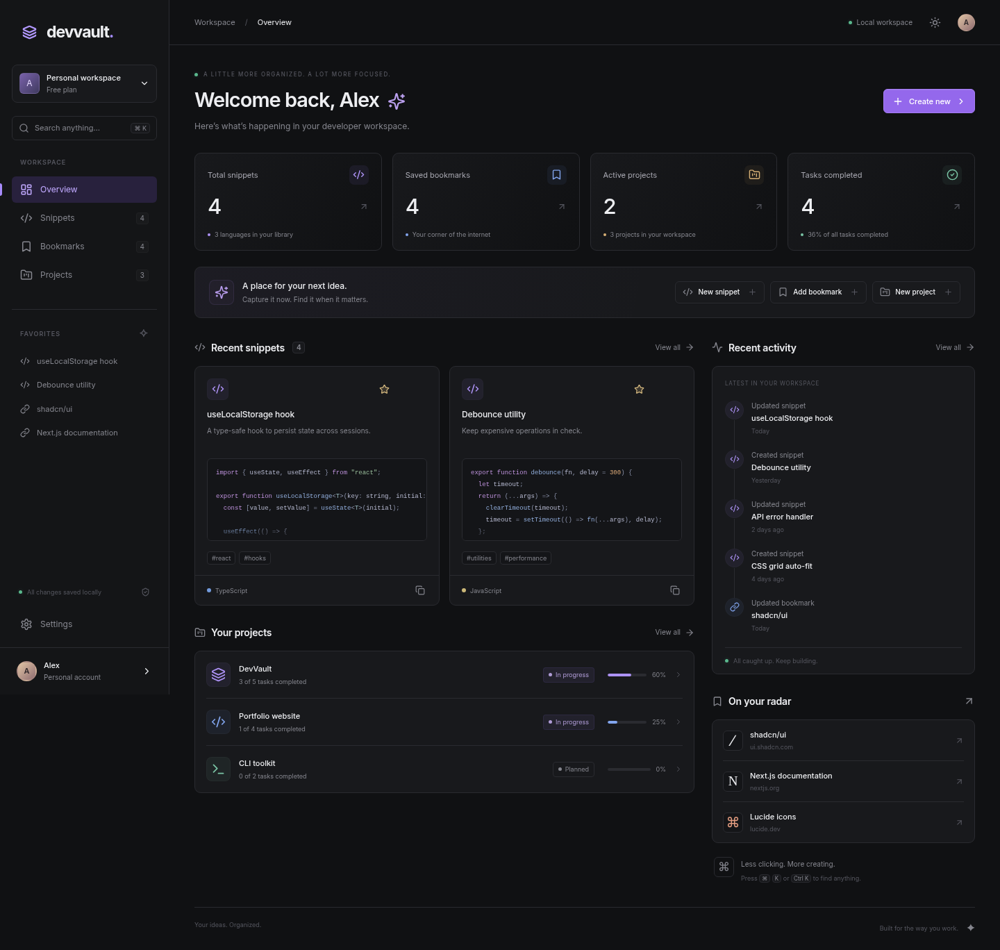
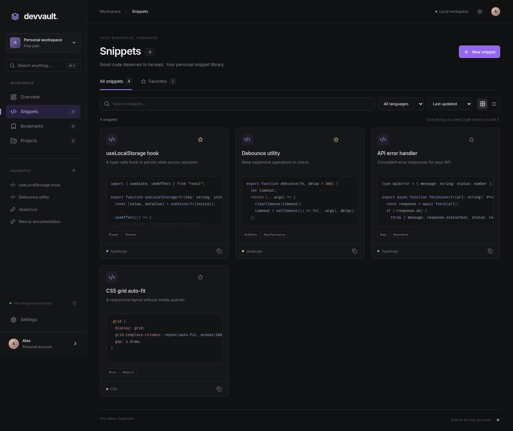
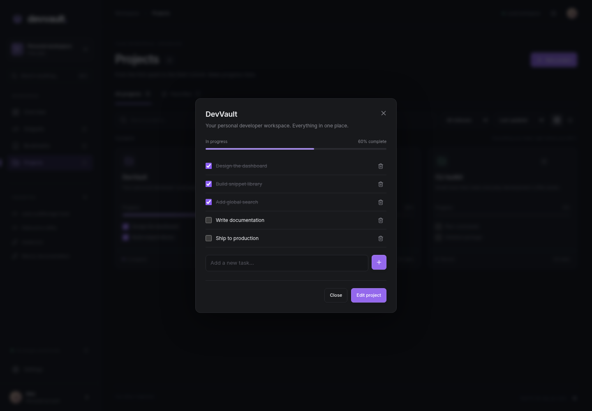
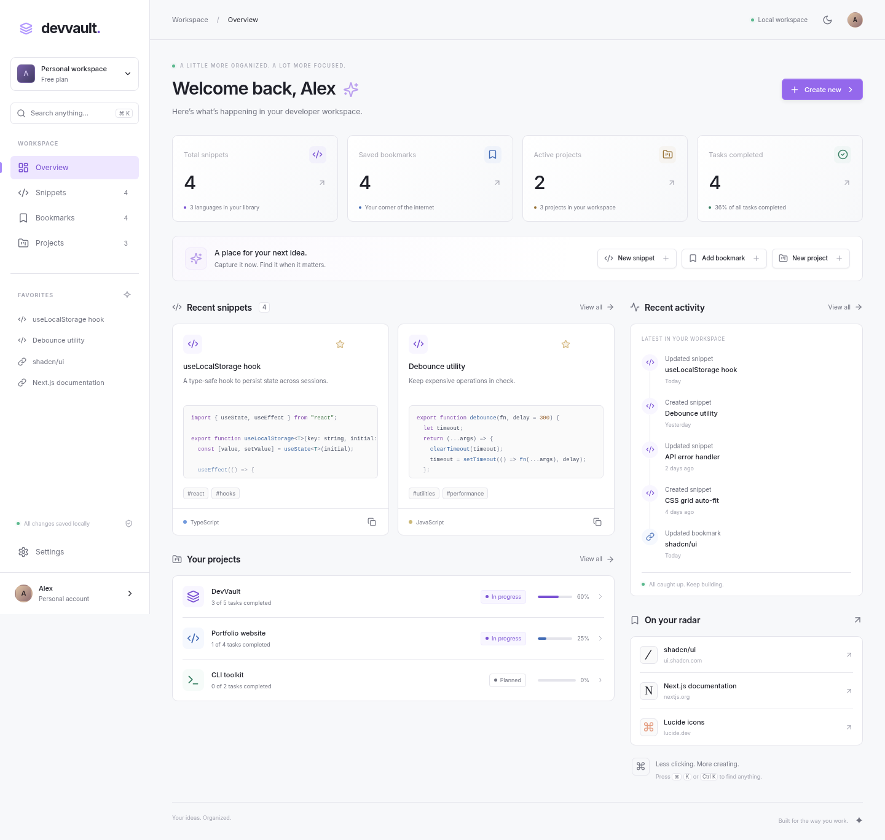
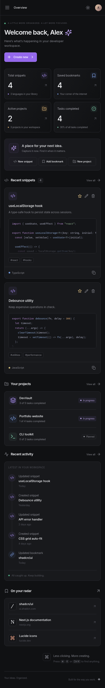

# DevVault

**A considered workspace for the things you build.**

DevVault brings your code snippets, useful resources, and project plans into one fast, local-first workspace. Inspired by the focus and restraint of Linear, Vercel, and Raycast, it pairs a graphite interface with quiet violet accents and useful details.

## Features

- **Dashboard:** live workspace statistics, recent snippets, project progress, saved resources, and activity history.
- **Snippet library:** create, view, edit, delete, favorite, and copy code. Syntax highlighting for TypeScript, JavaScript, Python, CSS, HTML, JSON, Bash, and SQL.
- **Bookmarks:** save HTTP/HTTPS resources with descriptions, categories, and tags; open resources in a new tab.
- **Projects:** manage project status and color; add, edit, complete, and remove tasks, with progress calculated automatically.
- **Search:** press `Ctrl+K` or `Cmd+K` to search titles, descriptions, tags, code, URLs, and project tasks across the workspace.
- **Library controls:** keyword search, category/language/status filters, favorites, sorting, and grid/table views.
- **Personalization:** persistent light/dark themes, display name, and compact layout.
- **Backups:** export versioned JSON and restore validated backups with a replacement confirmation.
- **Local persistence:** records, favorites, settings, tasks, and the latest 100 activity entries survive reloads.
- **First-run demo:** a curated, editable workspace. Restore it from Settings whenever you need a fresh start.
- **Resilient UX:** loading skeletons, empty states, accessible dialogs, toast feedback, storage failure handling, and route error boundaries.
- **Responsive:** collapsible mobile navigation, responsive grids, scrollable data tables, and reduced-motion support.

## Screenshots

Browser captures are stored in `public/screenshots/`. Replace them as your workspace evolves:

| View             | Suggested image                          |
| ---------------- | ---------------------------------------- |
| Dashboard / dark | `public/screenshots/dashboard-dark.png`  |
| Snippets         | `public/screenshots/snippets.png`        |
| Project tasks    | `public/screenshots/project-detail.png`  |
| Light theme      | `public/screenshots/dashboard-light.png` |
| Mobile           | `public/screenshots/mobile.png`          |







## Stack

| Layer             | Technology                                      |
| ----------------- | ----------------------------------------------- |
| Framework         | Next.js 16, App Router, React 19                |
| Language          | TypeScript, strict mode                         |
| Styling           | Tailwind CSS 4, semantic CSS variables          |
| UI primitives     | shadcn/ui conventions, Radix Dialog / Slot, CVA |
| State             | Zustand 5                                       |
| Persistence       | Browser localStorage                            |
| Icons             | Lucide React                                    |
| Code highlighting | Prism.js                                        |
| Notifications     | Sonner                                          |
| Validation        | Zod 4                                           |
| Tests             | Node test runner + tsx                          |

The reusable Button and Dialog components live in `src/components/ui`, with aliases and styling configured in `components.json` for extending the shadcn/ui component collection.

## Getting started

Requires **Node.js 20.9 or newer** and npm.

```bash
npm ci
npm run dev
```

Open [localhost:3000](http://localhost:3000). No environment variables, API keys, database, or sign-in are required.

```bash
npm run typecheck
npm test
npm run build
```

For browser checks, run `npx playwright install chromium` once, build with `npm run build`, then run `npm run test:e2e`. Playwright starts the production server automatically. The tests also refresh the screenshots. The production build uses Webpack for compatibility with restricted environments.

The build produces a static export in `out/`. To serve that production build locally:

```bash
npm start
```

`npm start` serves the production export using `serve`. Development uses the Next.js dev server.

## Deploy to Vercel

1. Push this project to your GitHub repository.
2. Import the repository into Vercel.
3. Use the **Next.js** framework preset and the default `npm run build` command.
4. Deploy. No environment variables are required.

The static export also works on any host that serves directory indexes and `.html` routes. For a static-only provider, publish the `out` directory and configure clean URL handling if required.

## Project structure

```text
src/
  app/                  App Router pages, metadata, theme tokens, global styles
    snippets/           Code snippet library
    bookmarks/          Resource library
    projects/           Projects and tasks
    settings/           Profile, appearance, imports and exports
  components/
    ui/                 Reusable Button and accessible Radix Dialog
    workspace.tsx       Sidebar, mobile navigation, global search, theme
    dashboard.tsx       Overview and activity
    library.tsx         Shared filtering, sorting, table/grid rendering
    record-card.tsx     Typed cards and syntax highlighting
    record-detail.tsx   Detail dialogs and task actions
    record-editor.tsx   Validated record editors and delete confirmation
    settings.tsx        Profile and backup controls
  lib/
    data.ts             Zod schemas, inferred types, demo records, progress
    store.ts            Zustand actions, local persistence, recovery
    utils.ts            Class names and date formatting
tests/
  vault.test.ts         Backup safety, CRUD, persistence, recovery, progress
  e2e/                  Browser workflows and mobile layout checks
```

## Data and privacy

All workspace data stays in localStorage under `devvault-v1`. The app makes no API requests to synchronize records. External bookmark links open only when clicked. Clipboard actions use the browser Clipboard API, which may require HTTPS or localhost.

Data is specific to the browser profile and site origin. Clearing site data removes the workspace, and another browser or deployment URL has a separate workspace. Export JSON backups to move between devices or deployments. Backups contain your code and URLs in plain text; store them appropriately.

Imports validate the schema, record IDs, task IDs, URL protocols, field lengths, version, and record limits before requesting confirmation. Files larger than 10 MB are rejected. Importing or restoring demo data replaces the current workspace. Export first if you want to retain it.

If stored JSON is corrupt, DevVault shows a recoverable demo view without overwriting the original storage during loading. A persistent alert explains the issue. If storage writes fail, changes remain available in memory for export.

## Keyboard and accessibility

- `Ctrl+K` / `Cmd+K`: toggle global search.
- `Escape`: dismiss dialogs.
- `Tab` / `Shift+Tab`: navigate interactive controls and dialog contents.
- `Enter` / `Space`: activate focused controls.
- `Enter` in a task entry field: add the task.

Dialogs provide focus trapping and accessible titles. Icon buttons have accessible names; theme and layout switches expose their state. Animations respect `prefers-reduced-motion`.
